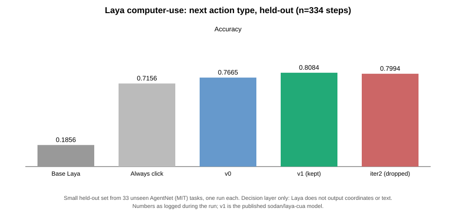
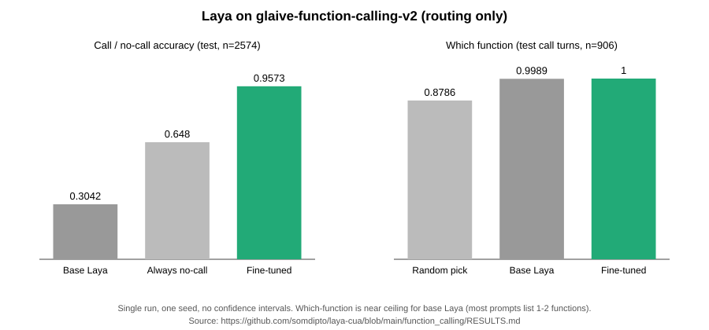

# laya-cua

Notebook: [laya_cua_finetune.ipynb](laya_cua_finetune.ipynb) (outputs cleared; runs on a free Colab T4).

Fine-tune [Laya](https://huggingface.co/convaiinnovations/laya) (421M ModernBERT-based decision encoder) to pick the next **computer-use action type** and whether the task is **done**, from a text description of the screen.

Model: https://huggingface.co/sodan/laya-cua (Apache-2.0)

## What it does
Given a task, a text screen description and the last few steps, one forward pass returns:
- the next action type: click, type, key, scroll, move, wait, drag, done
- the probability that the task is already finished

## What it does not do
No text generation, no click coordinates, no screenshots. It is a fast decision layer to sit next to whatever produces the target and the typed text. Unsloth does not apply: Laya is an encoder with a typed head, not an autoregressive LLM.

## Results (held-out, n=334 rows, single run each, free Colab T4)
| version | change | action_type | task_done |
|---|---|---|---|
| v0 | 200 AgentNet tasks, 2 epochs | 0.7665 | 0.9581 |
| v1 | 400 tasks, 2 epochs | 0.8084 | 0.9611 |
| base Laya | none | 0.1856 | 0.7066 |
| always "click" | none | 0.7156 | not computed |

Limits: small test set, one run per version, about 94% of rows are "not done" so task_done is near a trivial baseline, trained on AgentNet text descriptions only. Details and the live results log are on the model card.

## Function-calling routing (separate task)
Laya also decides call / no-call and which function on glaive-function-calling-v2. Test tool_call accuracy 0.9573 (base 0.3042, always no-call 0.648). Which-function is near ceiling for base Laya, so that gain is not meaningful. One run per library version, no confidence intervals. Weights: https://huggingface.co/sodan/laya-cua-tools. Details: [function_calling/RESULTS.md](function_calling/RESULTS.md).

## Files
- `agentnet_to_laya.py`: converts OpenCUA AgentNet (MIT) trajectories into Laya rows.
- `function_calling/laya_fc.py`: the function-calling routing run.
- Training: the official `laya.train` RLCD loop on one T4 (single run recipe: 2 epochs, encoder LR 2.5e-5, head LR 1e-4, batch 64). A notebook will be added to this repo.

## License
Apache-2.0. Data: [OpenCUA AgentNet](https://huggingface.co/datasets/xlangai/AgentNet), MIT.

